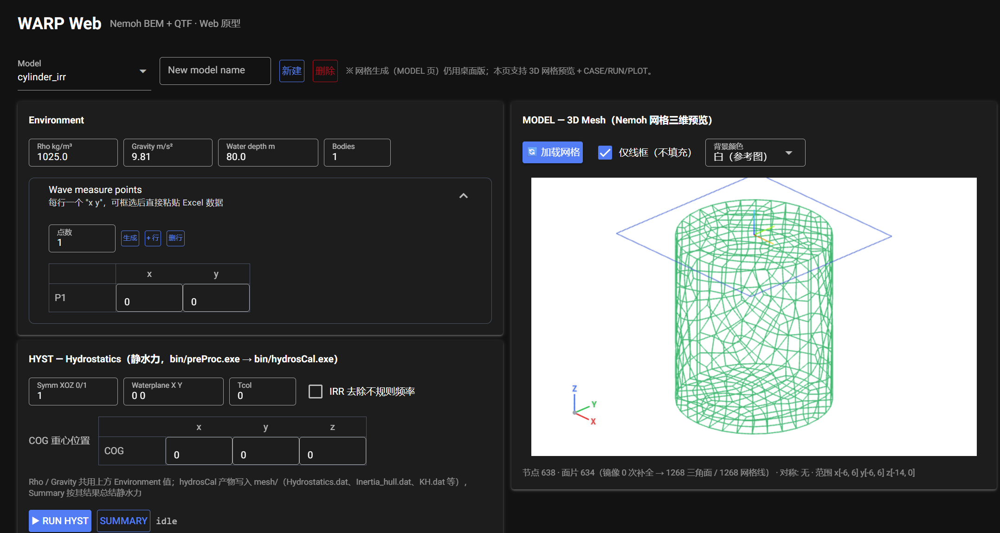

# WARP V2.0 — Wave-structure Analysis Response Program

WARP is a pre/post-processing tool for the open-source BEM solver **Nemoh** (LHEEA). It provides a browser-based GUI for entering and saving Nemoh input parameters, running the hydrostatics / BEM / QTF chains, previewing panel meshes in 3D and plotting first-order wave forces, motion RAOs, hydrodynamic coefficients and second-order QTF results.

> Current version supports **single-body** parameter input. Multi-body analysis still requires manual editing of the `.cal` file.



---

## 中文说明

WARP 是开源 BEM 求解器 Nemoh（LHEEA）的前后处理工具，通过浏览器界面完成 Nemoh 输入参数的输入与保存、静水力/BEM/QTF 计算链的调用、panel 网格三维预览，以及水动力系数、一阶波浪力、运动 RAO 与二阶 QTF 结果的查看。

### 功能

| 板块 | 内容 |
|---|---|
| **MODEL** | 模型列表与新建/删除；网格（`.dat`）导入与三维预览（按对称性镜像补全）；波浪测量点（支持批量粘贴、按点数生成行） |
| **HYST** | 静水力链路 `preProc.exe → hydrosCal.exe`，SUMMARY 汇总浮心/排水量/水线面面积/质量 |
| **参数** | RHO / 重力 / 水深 / COG；6 自由度开关；MASS 惯性、附加阻尼与刚度矩阵；Load Cases（频率与浪向类型/数量/范围、IRR、Kochin、自由面、RAO）；Solver（高斯积分阶数、eps_zmin、高斯消元或 GMRES 求解器）；Post Set；QTF Set |
| **计算** | `Save .cal` 生成 `Nemoh.cal`；`Save Mechanics` 生成 `input_solver.txt` 与 Mechanics 矩阵文件；`Run BEM` / `Run QTF` 后台运行，日志实时滚动；运行前旧结果目录自动改名为 `*_bak_<时间戳>`，不删除历史数据 |
| **Results** | 附加质量与辐射阻尼、一阶波浪力（Froude-Krylov + 绕射）、运动 RAO 曲线，支持浪向切换 |
| **QTF Results** | QTF 等高线四联图（幅值/相位/实部/虚部，`|QTF|/ρg` 取 log10 色标）与主对角线二阶载荷（平均漂移力口径） |

### 快速开始

```bash
# 1. 安装依赖（建议 Python 3.10+）
pip install -r requirements.txt

# 2. 启动服务
python warp_web.py        # 命令行启动；Windows 下也可双击 run.bat（自动选 Anaconda 并打开浏览器）
```

浏览器打开 <http://127.0.0.1:8300>，在模型列表中选择示例模型 `cylinder_irr`（网格与参数已就位），即可依次运行 HYST / BEM 体验全流程。

### 目录结构

```
WARP/
├─ warp_web.py          # Web 界面（NiceGUI）
├─ warp_core.py         # 计算与文件层：Nemoh.cal 生成、exe 调用链、结果读取
├─ read_index.py        # 索引/公共读取
├─ read_radia.py        # 附加质量（CM.dat）与辐射阻尼（CA.dat）
├─ read_force_rao.py    # 一阶波浪力与 RAO
├─ read_motion_rao.py   # 运动 RAO
├─ bin/                 # Nemoh / QTF 计算内核（Windows 可执行文件）
└─ db/cylinder_irr/     # 示例模型（网格 + 参数 + 结果）
```

> 完整的网页版使用帮助（MkDocs 文档站点）正在整理中，将在后续版本提供。

### 依赖内核与许可

- `bin/` 中的可执行文件来自 **Nemoh**（École Centrale Nantes / LHEEA），遵循 **GPL-3.0**。
- 网格查看依赖 **meshmagick**（LHEEA），遵循 **GPL-3.0**。
- 本仓库整体以 **GPL-3.0** 发布，详见 [LICENSE](LICENSE)。

### 已知限制

- 仅支持单体参数输入；多体需手工修改 `.cal`。
- `bin/` 提供的是 Windows 可执行文件，其他平台需自行编译 Nemoh 内核。
- 静水力（HYST）链路依赖 `preProc.exe` / `hydrosCal.exe`，运行前需先 `Save .cal`。

---

V2.0 is a complete rewrite: the desktop (Tkinter) interface is replaced by a browser-based Web UI. This is the first public release of the Web version. Feedback and issues are welcome to help improve future updates.

## License

GPL-3.0 — see [LICENSE](LICENSE). The bundled Nemoh executables (`bin/`) and the mesmagick dependency are third-party works by LHEEA, distributed under the same license.
