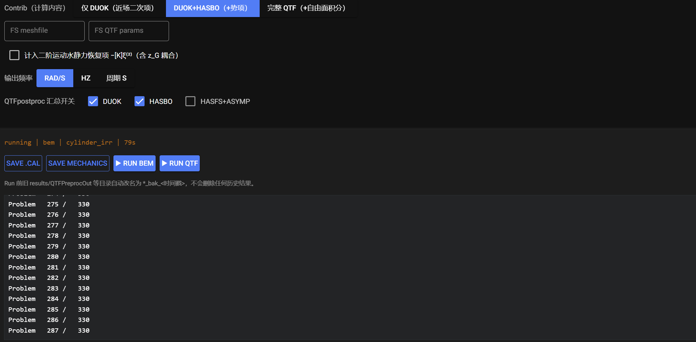

# 参数解释

各参数在界面上的位置见 [界面总览与工作流程](../workflow/workflow.md)。多数默认值取自 Nemoh 推荐设置；高级调整请参考 [Nemoh 手册](https://lheea.gitlab.io/Nemoh/)。

------------------------------------------------------------------------

## Environment（全局环境）

| 参数 | 含义 | 默认 |
|---|---|---|
| Rho kg/m³ | 水密度 | 1025.0 |
| Gravity m/s² | 重力加速度 | 9.81 |
| Water depth m | 水深（有限水深；大值近似无限水深） | 80.0（示例值，按实际填写） |
| Bodies | 参与计算的浮体数 | 1（当前仅支持单体） |

## Wave measure points（波浪测量点）

空间固定点的 `x y` 坐标列表，Nemoh 在这些点输出自由面高程 / 波浪时历。每行一个 `x y`，可直接从 Excel 粘贴两列数据；**点数 + 生成** 按行数批量补齐。不需要时保持一行 `0  0` 即可（程序不会写入冗余点）。

## HYST — Hydrostatics（静水力）

| 参数 | 含义 |
|---|---|
| Symm XOZ 0/1 | 网格关于 XOZ 平面的对称标志（Nemoh 网格文件头两列，2 0 = 无 XOZ 对称，2 1 = 有） |
| Waterplane X Y | 水线面原点位置 X, Y |
| Tcol | Z 方向吃水调整量 |
| IRR | 勾选后去除不规则频率（irregular frequency） |
| COG x y z | 重心位置 |

> **提示**：经对照验证，当前版本的静水力结果实际由 **COG 与 Rho / Gravity** 驱动（hydrosCal 以水线面自动求解平衡浮态）；Symm / Waterplane / Tcol 等字段保留用于与桌面版参数文件兼容，修改后不影响 SUMMARY 数值。

静水力结果写入 `mesh/`（`Hydrostatics.dat`、`Inertia_hull.dat`、`GC_hull.dat`、`KH.dat`），SUMMARY 按其结果汇总。程序会自动创建 `Mechanics/` 目录并从网格文件统计节点 / 面片数，无需依赖桌面版预生成的文件。

## Body set — Degrees of freedom

勾选参与辐射计算的自由度：Surge（纵荡）、Sway（横荡）、Heave（垂荡）、Roll（横摇）、Pitch（纵摇）、Yaw（艏摇）。

## MASS / Mechanics（质量与力学矩阵）

| 参数 | 写入文件 | 说明 |
|---|---|---|
| Mass (kg) | `Mechanics/Inertia.dat` | 结构质量 |
| Moment of inertia tensor (kg·m²) | `Mechanics/Inertia.dat` | 3×3 惯性张量（默认 0 = 交给程序处理） |
| 附加阻尼 D11..D66 | `Mechanics/Badd.dat` | 额外线性阻尼矩阵（如摇荡阻尼装置） |
| 附加刚度 S11..S66 | `Mechanics/Km.dat` | 额外刚度矩阵（如系泊 / 弹性支撑） |

矩阵区域支持框选后从 Excel 粘贴。**Save Mechanics** 时才会写盘；仅在需要额外阻尼 / 刚度时填写，否则保持 0。

## Load Cases（Nemoh.cal 波浪频率 / 浪向）

| 参数 | 含义 |
|---|---|
| Freq type | 频率类型：`1,2,3 = [rad/s, Hz, s]`（角频率 / 赫兹 / 周期） |
| Min freq / Max freq / N freq | 频率下限、上限与个数（Nemoh 按线性插值生成） |
| Min dir° / Max dir° / N dir° | 浪向下限、上限与个数（deg，0° = 沿 +X 入射） |

## Solver（input_solver.txt）

| 参数 | 含义 | 默认 |
|---|---|---|
| GQ | 高斯积分阶数：面元积分使用 N² 个高斯点，N 取 1–4 | 2 |
| eps_zmin | 源 / 汇点抬升系数：`zmin = eps_zmin × body_diameter`，避免奇异 | 0.001 |
| Solver | 0 = 直接法（高斯消元） | 0 |
| **GMRES**（勾选框） | 勾选后改用 GMRES 迭代求解（大规模网格更快） | **不勾选** |
| Restart | GMRES 重启参数 | 10 |
| Rel Tol | 相对收敛容差 | 1e-5 |
| Max iter | 最大迭代次数 | 1000 |

> **GMRES 使用建议**：默认（直接法）即可满足多数工况；当网格规模大、直接法内存 / 耗时难以接受时再勾选。参数 10 / 1e-5 / 1000 适用于大多数场景；若日志显示迭代收敛停滞，可把 Restart 提高到 30–50。

## Post Set（后处理开关）

| 参数 | 含义 |
|---|---|
| IRF a b c | 辐射 IRF（脉冲响应）输出的频率段：Min / Step / Max |
| Kochin a b c | Kochin 函数输出角度段，建议 `361 0 360`（每 1° 一个，覆盖整圆） |
| Free surface a b c | 自由面输出网格定义（Min / Step / Max） |
| Out freq type | 输出频率类型：`1,2,3 = [rad/s, Hz, s]` |
| Show pressure | 输出面元压力分布 |
| Calculate RAO | 计算 RAO（**必须先在 MASS 保存参数**，否则无质量 / 惯性数据） |

## QTF Set（二阶 QTF）

| 参数 | 含义 |
|---|---|
| 启用 QTF 计算 | 总开关（不勾选则 RUN QTF 不可用） |
| QTF freq set：N / Min / Max | QTF 径向频率的个数、下限与上限 |
| 浪向组合 | `单向 β1=β2`（同向入射）或 `双向 全组合`（双浪向全交叉组合） |
| Contrib（计算内容） | `1` 仅 DUOK（近场二次项）；`2` DUOK+HASBO（+势项）；`3` 完整 QTF（DUOK+HASBO+HASFS+ASYMP，需自由面积分） |
| FS meshfile | 自由面网格文件名（仅 Contrib 3 需要；不适用填 `NA`） |
| FS QTF params | `Re, Nre, NBessel`（自由面积分的 Bessel 展开参数，仅 Contrib 3） |
| 计入二阶运动水动力恢复项 -[K]^H2 | 二阶运动力恢复项（含 z-G 耦合） |
| 输出频率 | QTFpostProc 输出频率类型：`1,2,3 = [rad/s, Hz, s]` |
| QTFpostproc 汇总开关 | DUOK / HASBO / HASFS+ASYMP 是否计入总 QTF 输出 |

> QTF 参数组合复杂，请务必结合 [Nemoh 手册](https://lheea.gitlab.io/Nemoh/) 的 QTF 章节设置。
