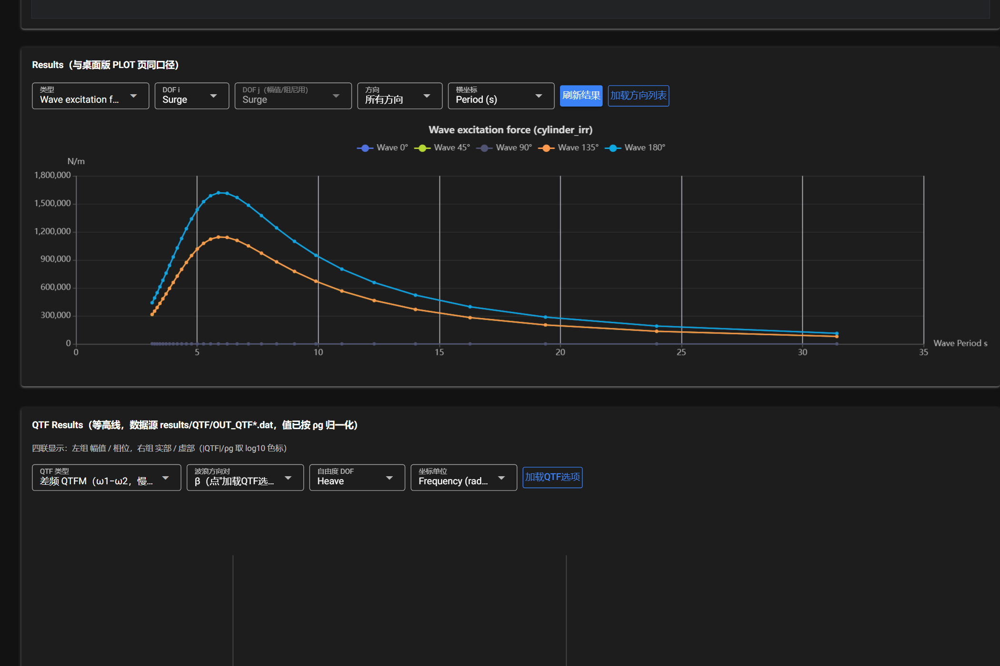
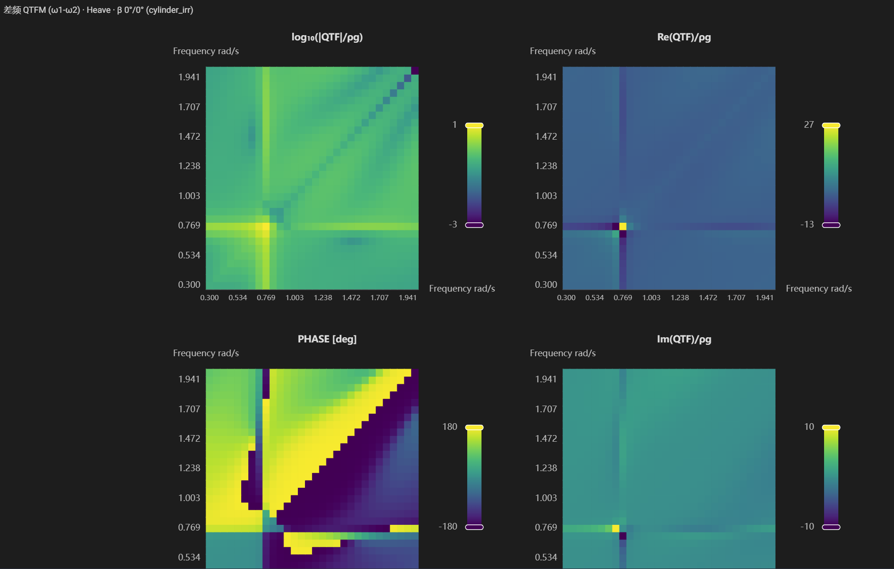
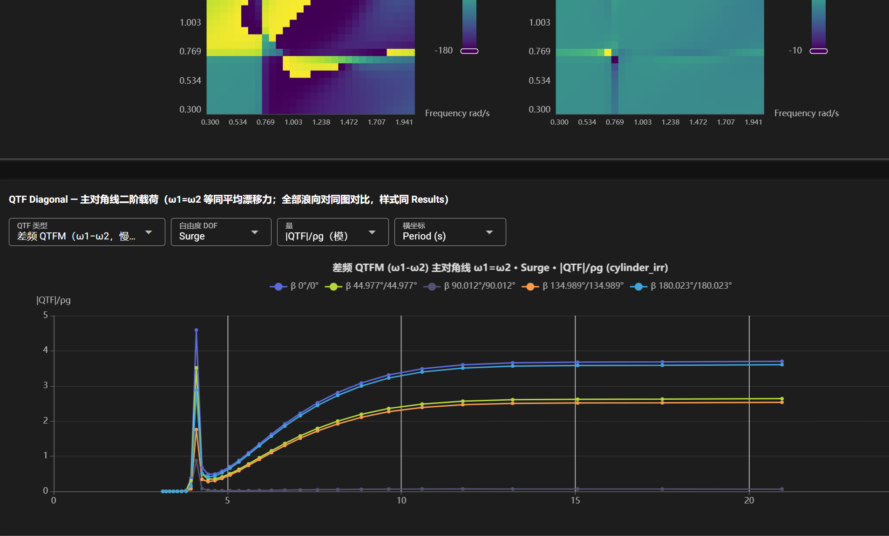

# 结果查看

BEM 完成后点击 **刷新结果** 载入数据；**加载方向列表** 用于载入浪向选项。

## Results（一阶结果曲线）

| 控件 | 说明 |
|---|---|
| 类型 | Wave excitation force（激励力）/ RAO / 附加质量 / 辐射阻尼等 |
| DOF i / DOF j | 作用方向与运动方向（转角用/作用矩用两个选择） |
| 方向 | 浪向（可叠画所有方向对比，`Wave 0° / 45° / …`） |
| 横坐标 | 频率或周期（rad/s / Hz / Period s） |

**单位口径**：

- 激励力按单位波幅归一化（`Fe(t) = a·|Fe|·cos(ωt − ∠Fe)`）：平动力 **N/m**，转动力矩 **N·m/m**。
- 附加质量 **kg**（转动为 kg·m²），辐射阻尼 **N·s/m**（转动为 N·m·s/rad）。
- 转动 RAO 的数据文件本身就是 **deg/m**，界面不再做弧度换算。

## QTF Results（二阶 QTF 等高线）

- 数据源：`results/QTF/OUT_QTF*.dat`（已按 ρg 归一化）。
- 四联图：左列 **幅值 / 相位**，右列 **实部 / 虚部**；色标取 `log10(|QTF|/ρg)`。
- 控件：QTF 类型（差频 QTFM (ω1−ω2) / 和频 QTFP (ω1+ω2) 等）、浪向组合 β、自由度 DOF、横坐标（频率 / 周期）。
- **加载QTF选项**：载入 `QTF Set` 的配置以确定可用组合。

## QTF Diagonal（主对角线二阶载荷）

- 取 `ω1 = ω2` 的对角项，即**等同平均漂移力**（mean drift force）口径。
- 全部浪向对同一图对比，样式与 Results 一致；支持 `|QTF|/ρg`（模）等纵坐标类型与频率 / 周期横坐标切换。

