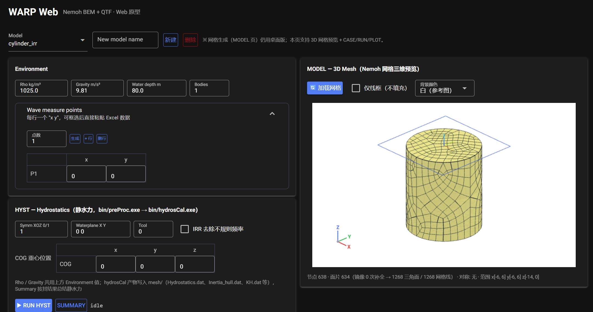
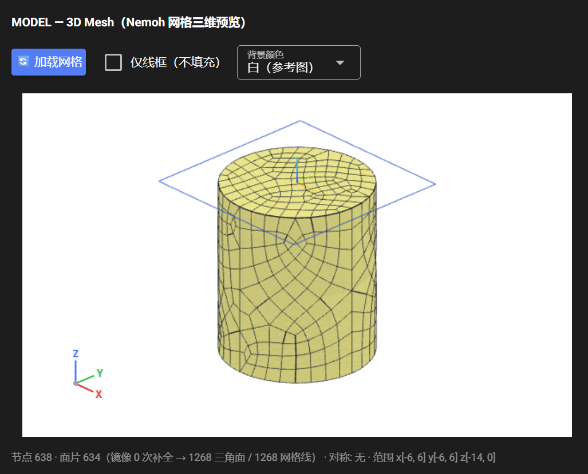
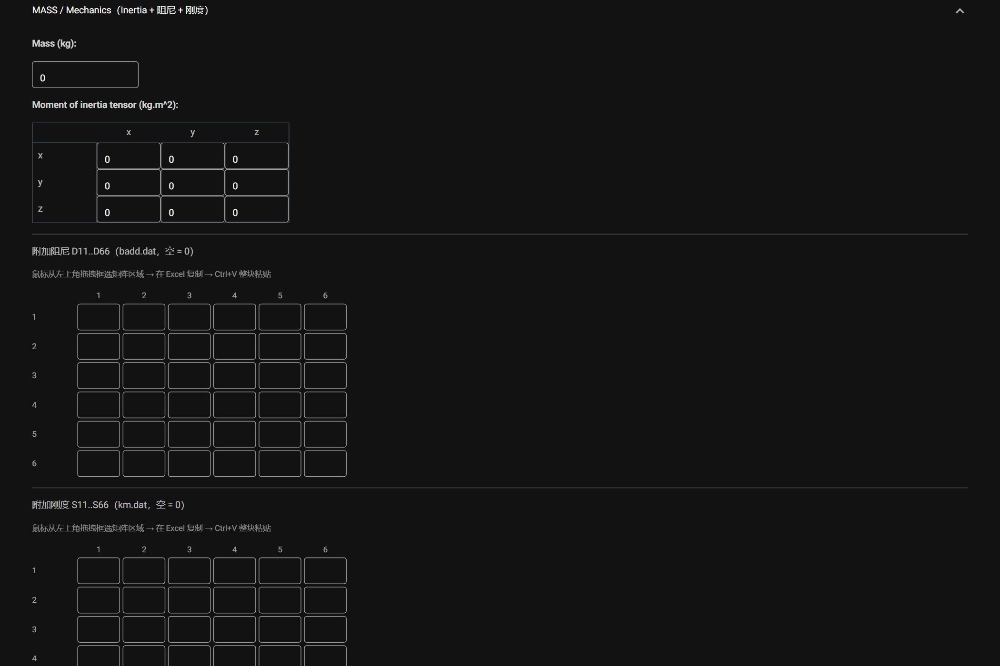
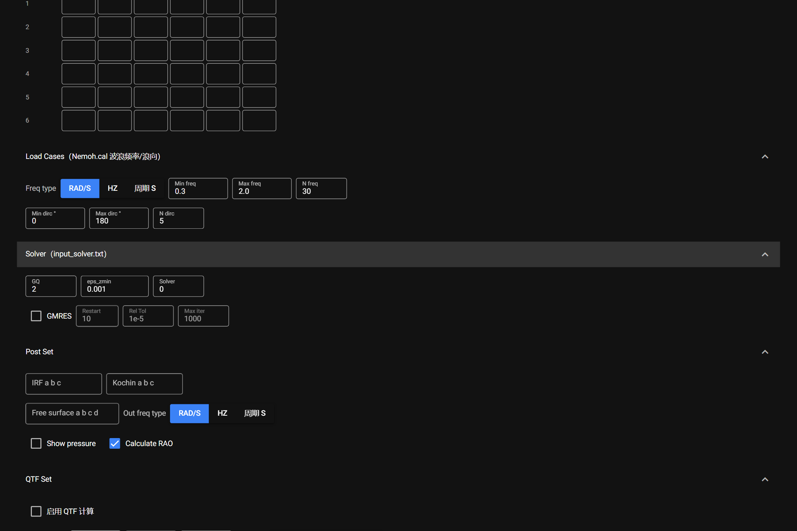

# Interface Overview and Workflow

The page is laid out top to bottom as: **Model area → Environment / measure points → HYST → 3D mesh preview → Body set / MASS → Load Cases / Solver / Post Set / QTF Set → Run buttons and log → Results → QTF Results**.

------------------------------------------------------------------------

## 1. Model management (top)

- **Model drop-down** — select an existing directory under `db/`; its parameters load automatically.
- **New model name + 新建** — create a model directory (English name, no spaces or special characters).
- **删除** — delete the selected model directory (confirmation dialog; blocked while a run is in progress).

> **Naming rule**: the mesh file must match the model name, i.e. `db/<model>/<model>.dat`. Names are case-sensitive; avoid `@ # space` and similar characters.

## 2. Environment

`Rho kg/m³` (water density), `Gravity m/s²`, `Water depth m`, `Bodies` (fixed at 1 in this version).

## 3. Wave measure points

- One `x y` pair per row; **select and paste two Excel columns directly** — rows are appended automatically.
- **点数 + 生成** generates that many rows in one click (keeping existing rows); `+ 行 / 删行` add or remove a single row.
- Written to the `wmpoints` block of `Nemoh.cal`; leave the default `0  0` when not needed (no extra points are written).

## 4. HYST — Hydrostatics

Chain: `bin/preProc.exe → bin/hydrosCal.exe`.

- **▶ RUN HYST** — rebuilds `mesh/` (previous directory renamed to `*_bak_<timestamp>`), copies the mesh, fixes the panel counters, then runs.
- **SUMMARY** — summarises `mesh/Hydrostatics.dat` into `summary_hydrosta.txt`: centre of buoyancy XB/YB/ZB, displacement, waterplane area and mass.
- `Rho / Gravity` are shared with the Environment panel.

## 5. MODEL — 3D Mesh preview

- **加载网格** — parses `db/<model>/<model>.dat` and renders it; the symmetry flag in the first line is used to mirror a half model automatically.
- **仅线框（不填充）** / **背景颜色** toggle the display style.
- Node count, panel count (after mirroring), symmetry and bounding box are printed under the view.

## 6. Body set — degrees of freedom

Select the DOFs to solve: Surge / Sway / Heave / Roll / Pitch / Yaw. Unselected DOFs are excluded from the radiation problem.

## 7. MASS / Mechanics

- **Mass (kg)** — structural mass.
- **Moment of inertia tensor (kg·m²)** — 3×3.
- **Added damping D11..D66 (badd.dat)** and **added stiffness S11..S66 (km.dat)** — 6×6 matrices; paste a block straight from Excel.
- Leaving everything at 0 lets the program derive the values from the hydrostatics results (recommended unless extra damping or stiffness is required).

## 8. Load Cases / Solver / Post Set / QTF Set

These four collapsible panels map to the corresponding sections of `Nemoh.cal` and `input_solver.txt`; every field is described in [Parameter Reference](../params/params.md).

## 9. Run buttons and log

- **SAVE .CAL** — writes `Nemoh.cal` (required before BEM / QTF).
- **SAVE MECHANICS** — writes `input_solver.txt` and the four matrices under `Mechanics/`.
- **▶ RUN BEM** / **▶ RUN QTF** — run in the background; the log below streams **in real time** (one line per problem).
- Before each run the old `results/`, `QTFPreprocOut/`, … are renamed to `*_bak_<timestamp>`; **no historical result is ever deleted**.

## 10. Results / QTF Results

See [Results](../results.md).

------------------------------------------------------------------------

## Key notes

- **File naming** — model and project files must share the same name (case-sensitive).
- **Order of operations** — HYST (optional) → SAVE .CAL → SAVE MECHANICS → RUN BEM → RUN QTF.
- **RAO curves** — tick `Calculate RAO` in Post Set after saving MASS parameters, then re-run BEM.
- **QTF** — QTF Set must be configured and the first-order problem (BVP + RAO) solved first.

## Recommended practice

- Keep the default solver settings unless there is a specific reason to change them.
- Check mesh quality and symmetry in the 3D preview before production runs.
- Back up `db/` regularly (automatic backups only cover run-time snapshots).
- Consult the [Nemoh manual](https://lheea.gitlab.io/Nemoh/) for advanced settings.
